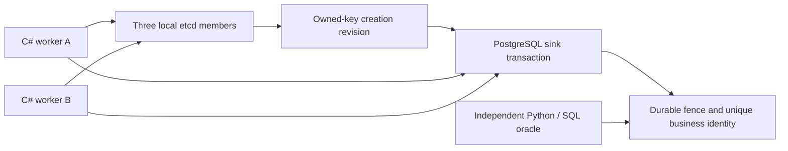

# Fenced Shard Ownership Lab

A small C#/.NET lab that makes a stale-writer failure reproducible: pause one worker, transfer ownership, then resume the old request. The PostgreSQL sink rejects its old fencing generation. A separate durable business identity prevents duplicate effects when the new owner retries an uncertain operation.

Synthetic, local and single-machine only. No exchange, market data, orders, account credentials, strategy, production HA or speed claim.

## Architecture review

Read the [architecture case study](docs/ARCHITECTURE-CASE-STUDY.md) for the decision, rejected alternatives, failure examples, frozen-release evidence and short English/Persian introductions. Follow the [30-minute four-project review](https://github.com/pouriajamali/trading-execution-lab/blob/main/docs/FLAGSHIP-REVIEW.md) for a guided discussion. The [evidence index](docs/FLAGSHIP-EVIDENCE.json) separates runtime/tag CI from later documentation commits.

## Current source candidate

The local source candidate is version **0.1.0-preview.3**, targeting SDK **10.0.404** and self-contained Core runtime **10.0.15**. The eight receipt-oracle vectors passed normally and with optimization on native Windows/Linux. The original 41 C# units passed on Windows and on the current replacement Linux instance. Locked restore, scoped managed advisory queries and the two actual runtime notice identities have been checked. The unchanged etcd3.7.3 source now has two equal Go1.26.11 builds, closed frozen source/binary advisory checks, independent serving admission and a successful guarded native version check. Five retained PostgreSQL/library archives and the admitted image prepared successfully without starting services.

**Local M1 acceptance is blocked by the native Linux task cap.** Exact `925d1d0` Windows/Linux packages passed native manifest/Core15/notices/SBOM checks. Its Windows packaged client passed all16 cases with five effects/total165 under the coallocated1GiB+3GiB budget and verified terminal teardown. Linux completed four cases before a concurrent client exited137 without JSON. A separate minimal diagnostic confirmed64 actual tasks and four `pids.events max` failures, with zero memory OOM events; thread creation in SocketAsyncEngine failed. This is an enforced task-limit failure. The64-task ceiling, four concurrent clients and scenarios remain unchanged. A128-task native-Linux-only exception is proposed privately and has not been authorized or executed. The complete tested signed M1 candidate is not ready.

Public delivery remains a separate exact gate. The shared actionlint public producer release/hosted CI and this project's accepted signed local tooling candidate establish tooling evidence only. They do not establish this application's hosted CI or authorize its publication. Historical download links below remain preview.2.

The source adds independent checks of all four original receipt fields, including the original commit total and generation after a lost acknowledgement and cutover. The one additional composed case keeps five effects/total165 and checks that an old owner's changed payload is still rejected as stale before identity conflict. See the [source evidence status](docs/W2-M1-RECEIPT-EVIDENCE.md) and [unreleased candidate notes](docs/RELEASE-v0.1.0-preview.3.md).

## Start with the failure

The demo runs these independently checked examples:

| Question | Evidence |
| --- | --- |
| Can a paused old worker write after committed cutover? | `paused-inflight-application-rejected-after-cutover`: rejected, no effect. |
| Did a process die before or after an effect commit? | Before-commit lookup is absent; commit-before-ack lookup finds one durable receipt. Retry uses the same business identity. |
| Does retrying under a new generation duplicate the effect? | Original receipt is replayed; PostgreSQL uniqueness is independent of the fencing token. |
| Does losing two of three etcd members grant new ownership? | Acquisition fails; the demo reports unavailable coordination rather than inventing ownership. |
| What survives an ordinary database process restart? | Committed fencing state, effect identities, hashes and results, checked through a separate SQL-history oracle. |

The frozen preview.2 demo has 15 named cases, including a stable OpenTelemetry trace check. The exact925d1d0 Windows packaged candidate passed all16 cases, including the new composed case. Native Linux stopped after four cases at its task cap; a complete Linux16-case result is not established. The receipt records the actual client OS, version/commit, cases, attempted commands and independent SQL checks. It ends with five unique synthetic effects and total 165. That is a fixture invariant, not trading volume or a benchmark.

## Run the preview

Published preview: [`v0.1.0-preview.2`](https://github.com/pouriajamali/fenced-shard-ownership-lab/releases/tag/v0.1.0-preview.2). Download **[Windows x64](https://github.com/pouriajamali/fenced-shard-ownership-lab/releases/download/v0.1.0-preview.2/fenced-shard-ownership-lab-v0.1.0-preview.2-win-x64.zip)**, **[Linux x64](https://github.com/pouriajamali/fenced-shard-ownership-lab/releases/download/v0.1.0-preview.2/fenced-shard-ownership-lab-v0.1.0-preview.2-linux-x64.tar.gz)** or [source](https://github.com/pouriajamali/fenced-shard-ownership-lab/releases/download/v0.1.0-preview.2/fenced-shard-ownership-lab-v0.1.0-preview.2-source.zip). Get the [checksums](https://github.com/pouriajamali/fenced-shard-ownership-lab/releases/download/v0.1.0-preview.2/SHA256SUMS.txt), [checksum signature](https://github.com/pouriajamali/fenced-shard-ownership-lab/releases/download/v0.1.0-preview.2/SHA256SUMS.txt.sig) and [public key](https://github.com/pouriajamali/fenced-shard-ownership-lab/releases/download/v0.1.0-preview.2/SIGNING-PUBLIC-KEY.pub); verify downloaded bytes with [PROVENANCE.md](PROVENANCE.md) before executing them. Local builds and CI artifacts are separate from published releases.

Earlier [preview.1](https://github.com/pouriajamali/fenced-shard-ownership-lab/releases/tag/v0.1.0-preview.1) is retained unchanged. Its managed-package SPDX checksums mislabeled normalized NuGet contentHash as a raw signed archive checksum, and its runtime lacked that raw checksum. Preview.2 records the two identities separately and independently verifies actual archive bytes. This metadata correction is not evidence of release-archive or signature tampering.

The native CLI does not require an installed .NET SDK. Python 3.12 and existing Ubuntu 24.04/Linux are needed for the full demo; Windows uses an existing `Ubuntu-24.04` WSL distribution for the servers. No Docker daemon, package installation or paid service is required by this path. The fixture archives are downloaded separately and checksum-pinned.

First inspect the package:

```powershell
.\ownership.exe --help
.\ownership.exe --version
```

Linux uses `./ownership` for those commands. Both help/version are offline. See [PROVENANCE.md](PROVENANCE.md) to verify source/tag and archive signatures. Git provenance is separate from Windows Authenticode or production suitability.

The server commands below describe the frozen historical preview. For current-source work, follow [the fixture build contract](docs/ETCD-FIXTURE-BUILD.md) and [the runbook](docs/RUNBOOK.md): preparation and integration require actual aggregate kernel limits before execution. Windows integration additionally requires a bounded native Job and a fresh `--service-unit`. Bare historical commands do not supply those current-source limits. Offline CLI help/version remain separate.

### Windows client and Linux services

Run from the extracted package in PowerShell. Use fresh `artifacts` paths for each attempt; existing output directories are deliberately not overwritten.

```powershell
python tools/fetch_services.py --out artifacts/upstream
if ($LASTEXITCODE -ne 0) { throw 'Fixture download failed' }
$linuxHere = (wsl -d Ubuntu-24.04 -- wslpath -a (Get-Location).Path).Trim()
if ($LASTEXITCODE -ne 0) { throw 'Existing Ubuntu WSL access required' }
wsl -d Ubuntu-24.04 -- python3 "$linuxHere/tools/prepare_linux.py" --archives "$linuxHere/artifacts/upstream" --out "$linuxHere/artifacts/services"
if ($LASTEXITCODE -ne 0) { throw 'Linux preparation failed' }
python tools/integration.py --fixtures artifacts/services --cli ownership.exe --out artifacts/demo
if ($LASTEXITCODE -ne 0) { throw 'Demo failed; preserve its evidence' }
Get-Content artifacts/demo/receipt.json
```

### Native Linux client and services

```sh
python3 tools/fetch_services.py --out artifacts/upstream &&
python3 tools/prepare_linux.py --archives artifacts/upstream --out artifacts/services &&
python3 tools/integration.py --fixtures artifacts/services --cli ./ownership --out artifacts/demo &&
cat artifacts/demo/receipt.json
```

The helpers extract verified upstream `.deb`/tar archives into the selected directory; they do not install packages or change system services. PostgreSQL data lives in a fresh user-owned Linux temporary directory. Each profile owns its processes, binds loopback, and stops those processes at completion. Scratch data/logs are retained for inspection. `connection.private.json` contains an ephemeral lab-only password: keep the whole demo directory private and out of commits, uploads and release archives.

## Architecture and choices



- .NET 10 LTS / C# 14; current-source target SDK 10.0.404/runtime 10.0.15 with unchanged managed dependency locks. Full candidate package/fault validation is pending; frozen preview.2 used SDK 10.0.403/runtime 10.0.14.
- etcd 3.7.3 is existing consensus; this project does not implement Raft. A small bounded `HttpClient` adapter uses its official v3 gateway.
- PostgreSQL 18.6 / Npgsql 10.0.3 enforce the sink transaction. Two workers plus three etcd members still have one physical host and one database sink.
- xUnit v3 package 4.0.3 covers exact integers, framing, domain bounds and fail-closed validation. The independent SQL oracle reconstructs effects instead of trusting the application's snapshot command.
- OpenTelemetry 1.20.1 can export a whitelisted trace to stderr when `OWNERSHIP_LAB_TELEMETRY=1`. It emits no SQL text, payloads, business identities, credentials or connection strings; default mode is off. This is one trace path, not a hosted observability platform.

[Contract](docs/CONTRACT.md) · [Architecture decision](docs/ADR-001.md) · [Failure matrix](docs/FAILURE-MATRIX.md) · [Runbook](docs/RUNBOOK.md) · [Contributing](CONTRIBUTING.md)

## Important boundaries

Cutover is committed sink activation, not merely lease expiry or election. The sink atomically checks the active generation and writes the effect/receipt. The business deduplication key survives generation changes. A timeout/disconnect is not a rollback receipt: a possibly committed operation is `UNKNOWN` until same-identity lookup/retry resolves it.

An already-started request paused before the state lock is an application-delay fixture, not a measured network-packet delay. The demonstrated sink restart is ordinary process restart. Arbitrary database rollback/restore and coordinator-lineage reset are unsupported; the lab supplies no admission/reset path after them and does not claim universal rollback detection. Workers and the local fixture controller are trusted, non-Byzantine participants; fencing is not authentication.

etcd's documented support is Tier 1 on Linux AMD64/ARM64 and Tier 3 on Windows AMD64. This lab uses the Linux service profile and independently executes native Windows/Linux clients. Shared CI timing and WSL timing are not exchange or hardware latency evidence.

## Build and verify source

Install the pinned SDK in an existing development environment. From this checkout:

```sh
python tools/test_receipt_oracle.py --out artifacts/receipt-oracle-normal
python -O tools/test_receipt_oracle.py --out artifacts/receipt-oracle-optimized
dotnet restore tests/Ownership.Tests/Ownership.Tests.csproj --locked-mode
dotnet run --project tests/Ownership.Tests/Ownership.Tests.csproj -c Release --no-restore -- -noLogo
python tools/test_notices.py --out artifacts/notices-tests
python tools/test_verifier.py --out artifacts/verifier-tests
dotnet restore src/Ownership.Cli/Ownership.Cli.csproj --locked-mode
dotnet build src/Ownership.Cli/Ownership.Cli.csproj -c Release --no-restore
```

The verifier regression creates only a disposable attacker key for negative cases; keep that private work directory out of uploads. It also verifies an actual tiny synthetic fixture signed by the established maintainer key, including normal, -O and PYTHONOPTIMIZE modes. No private maintainer key is needed to run tests.

The full Linux/Windows demo can also use a built DLL with `--cli <absolute-ownership.dll> --dotnet <absolute-dotnet>`. Release packaging requires a clean exact commit and preserves full per-component license texts/copyrights, a shipped-dependency SBOM, manifest and separate external-service lock references. Missing or altered notice text stops packaging. Windows CI checks native code/package execution; Linux CI additionally runs real local service faults. Actual Windows-to-WSL full-demo evidence is a separate check, not inferred from Windows unit CI.

Original code: MIT. Third-party software and separately downloaded fixtures retain their own licenses; see [NOTICE.md](NOTICE.md). No private/shared project code or data is included.

[CI resource policy](docs/CI-POLICY.md): documentation-only changes get real lightweight document/pipeline checks; source, tag and manual runs retain native validation. Published runtime tags and release assets remain unchanged.

## Source readability

The current source expands compact C# layout for review. The published preview links identify its frozen runtime release. Formatting preserves complete syntax, token text and values, comments and directives; it does not introduce a runtime behavior or performance claim.

To reproduce a published package, use its exact original runtime source: [v0.1.0-preview.1 source](https://github.com/pouriajamali/fenced-shard-ownership-lab/tree/7c853fde7bf2aeab9bf60f6b6e979cb17738d802) (`7c853fde7bf2aeab9bf60f6b6e979cb17738d802`), [v0.1.0-preview.2 source](https://github.com/pouriajamali/fenced-shard-ownership-lab/tree/ea35e6a664931b1972c348796a9b7edae9e51378) (`ea35e6a664931b1972c348796a9b7edae9e51378`). Later `main` layout is reviewed separately from those frozen release commits.

## Build-time sealed linter

Fresh CI/contributor lint imports the exact reviewed public sealed archive; no
producer drive/private receipts or local compiler are required. Managed task
checkouts retain the canonical gate. See [native profile and signed input setup](docs/ACTIONLINT-BUILD.md).
Archive availability and hosted cap acceptance require actual release/CI readback.
