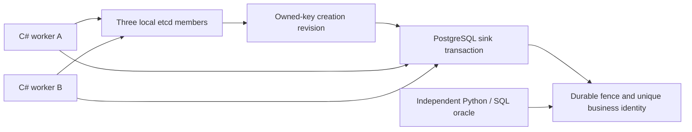

# Fenced Shard Ownership Lab

A small C#/.NET lab that makes a stale-writer failure reproducible: pause one worker, transfer ownership, then resume the old request. The PostgreSQL sink rejects its old fencing generation. A separate durable business identity prevents duplicate effects when the new owner retries an uncertain operation.

Synthetic, local and single-machine only. No exchange, market data, orders, account credentials, strategy, production HA or speed claim.

## Architecture review

Read the [architecture case study](docs/ARCHITECTURE-CASE-STUDY.md) for the decision, rejected alternatives, failure examples, frozen-release evidence and short English/Persian introductions. Follow the [30-minute four-project review](https://github.com/pouriajamali/trading-execution-lab/blob/main/docs/FLAGSHIP-REVIEW.md) for a guided discussion. The [evidence index](docs/FLAGSHIP-EVIDENCE.json) separates runtime/tag CI from later documentation commits.

## Technology refresh in progress

The preview.8 branch targets SDK11.0.100, net11.0, stable C#15.0 and self-contained Core11.0.0 on Windows x64 and Linux x64. Producer04's exact 38 signed package inputs and actual Core11 runtime notice mappings are bound to the local consumer contract. Three real SDK-generated net11/both-RID lock files replace the historical net10 locks. Direct package versions stay Npgsql10.0.3, OpenTelemetry1.20.1 and xUnit4.0.3.

The first bounded Windows lock phase passed all three restores in55.016seconds under its original600-second/4GiB/CPU2/64-task envelope; actual owned population reached0 and the canonical lease was released. The SDK's actual packagesToPrune metadata removes framework-provided abstractions; no dependency graph was manually relabelled. This is restore evidence only. The50 C# tests, both native packages, original16-case SQL/runtime scenarios, five effects/resource profiles and signed publication remain required.

GitHub Actions remain prohibited. Local operators bind current clean source, original phase clocks, actual kernel controls and exact producer inputs through the existing controller. Preview.7 below remains the latest verified downloadable release; no preview.8 download is claimed. See [preview.8 delivery notes](docs/RELEASE-v0.1.0-preview.8.md).

## SDK11 shared input source and current execution boundary

The maintenance source binds all 62 byte-identical shared files from producer04 commit `4dab824c2b0b6fe00858f648d07fd8e9df9fafe1`: transport `c37e2f48...`, normal catalog `8995a4d2...`, Linux fact/acceptance `757abf2d...`/`0452e1f3...` and Windows fact/acceptance `ec8e9b40...`/`9713a70f...`. These are source and historical producer evidence. Own06 must independently establish clean source, tracked contract/profile/full source pins, actual held MainPID/start, kernel limits, original deadline and typed terminal. No current input, product or global SDK readiness follows.

A Windows producer fact exists for its GitHub-hosted Server2025 host. That history is distinct from the local Windows26H2 experimental byte history. The separate local input facade is copied exactly from producer04 signed local source9fe8f25 (base manifest0ab12264), with both complete catalogs and the optional fixed local Job helper from306e1d67. The hosted Windows caller remains fail closed; its API is not silently replaced.

The owner-only operator entry `python -I -S -B tools/ci_pipeline.py --local-windows-input --expected-commit <clean-own-HEAD>` performs P0 read-only input checks for the future P3 caller. It has a single60-second envelope including teardown,4GiB/CPU2/64, a held main in its own named no-breakaway/kill-on-close Job, actual original-parent/start/caps/source/profile/pins and one canonical lease. It executes zero SDK targets and does not acquire/copy/delete the shared SDK. Its result is recorded outside source in the own execution-evidence directory. Current package CMS/normalized identities/notices/advisories, graph/locks, C# tests and native/product acceptance remain separate gates. This source entry is not a product or general OS-support claim.

P3 Windows build input retains4GiB/CPU2/64/900 as an upper contract; this input-only P0 uses the smaller60-second row. Original R06 remains the separately gated binary-only Windows/WSL paired compatibility scenario with1GiB/CPU1/16 plus3GiB/CPU1/48; no SDK runs in R06. Retired LinuxR3 is not reused.

The Linux input worker retains generic4GiB/CPU2/tasks64/swap0; only the original explicit native-linux-16 runtime uses128 tasks. Existing verify rows remain900seconds/max-parallel1, with one monotonic deadline captured before checkout and no transport clock reset. Core/Host native-pack metadata is reused; the actual06 console/library graph does not require ASP.NET. Package bytes/signatures/normalized identities/full notices/audits and all original product/native/scenario/release gates remain necessary. No published preview.8 package is claimed here.

## Runtime preview and publication status

The published native runtime is **0.1.0-preview.7**, built from signed source `bff39cd89822ceba07fce68c4dcdbf5819f09254` and tree `86b1d92d1d4f90a3842b436f6bd4b099c7da3d2d` with SDK **10.0.404** and self-contained Core runtime **10.0.15**. [Exact tag CI, attempt1](https://github.com/pouriajamali/fenced-shard-ownership-lab/actions/runs/43372419271) passed policy, native Windows/Linux and aggregate validation. The [release](https://github.com/pouriajamali/fenced-shard-ownership-lab/releases/tag/v0.1.0-preview.7) provides all six assets; their downloaded hashes and known-key SSH signature were verified.

Fresh evidence from this run: **41 C# units on each OS**, and **8 verifier tests / 27 scenarios on each OS** in normal, `python -O` and `PYTHONOPTIMIZE=1` modes. Native packaged CLI help/version and external-endpoint rejection ran on each OS. Native Linux additionally passed **16 integration cases**; an independent retained-data review compared **21 SQL snapshots**. That fresh integration scope is Linux only. Earlier Windows-to-WSL integration evidence is historical and separate; this run does not establish a new Windows16 result.

Both native packages have347 payload files, full original license/copyright coverage for18 shipped components, manifest/SBOM checks and `localCandidate=false`. The source ZIP contains the exact104 Git blobs at the runtime tag. The archives retain their tested build-time README/source snapshot. Current repository docs and release notes carry later publication status; documentation updates do not rebuild or repack these tested archives. Documentation-only main revisions have a different SHA from the frozen runtime tag source printed above.

Preview.7 retains `UseSharedCompilation=false`, adds only validated `PROGRAMDATA` as the third Windows machine-path key, and uses15-minute native job ceilings. The Linux service allowlist, SDK maps/full notices, C#/SQL, fixtures, ten-second owned-descendant guard, service/Job caps and teardown contracts stay fixed. Linux verify/prepare use4GiB/twoCPU/64 tasks/zero swap; only the explicit native-linux-16 runtime uses128 tasks. Missing actual owned-terminal/release/counter evidence means HOLD, including after a host timeout.

Failed tags preview.3/4/5/6 remain immutable; preview.6 failed Windows command07 while its command01/02 completed. Its Windows XML and hosted SSH inner error/identity were not retained. Controlled local PROGRAMDATA evidence supports the local correction; the fresh preview.7 receipts demonstrate bounded current behavior without proving the old process identity or causal explanation. See [preview.6 history](docs/RELEASE-v0.1.0-preview.6.md) and [preview.7 notes](docs/RELEASE-v0.1.0-preview.7.md).

[Build attestation](https://github.com/pouriajamali/fenced-shard-ownership-lab/attestations/67037698) subjects, source/run/attempt and included-leaf DSSE signature math/canonical workflow SAN were independently checked. Independent Fulcio-root and Rekor trust were **not** verified. No SLSA level, production HA, latency, customer use or general security/certification claim follows. Release SSH signature verification is described in [PROVENANCE.md](PROVENANCE.md).

## Start with the failure

The demo runs these independently checked examples:

| Question | Evidence |
| --- | --- |
| Can a paused old worker write after committed cutover? | `paused-inflight-application-rejected-after-cutover`: rejected, no effect. |
| Did a process die before or after an effect commit? | Before-commit lookup is absent; commit-before-ack lookup finds one durable receipt. Retry uses the same business identity. |
| Does retrying under a new generation duplicate the effect? | Original receipt is replayed; PostgreSQL uniqueness is independent of the fencing token. |
| Does losing two of three etcd members grant new ownership? | Acquisition fails; the demo reports unavailable coordination rather than inventing ownership. |
| What survives an ordinary database process restart? | Committed fencing state, effect identities, hashes and results, checked through a separate SQL-history oracle. |

The frozen preview.2 demo has 15 named cases, including a stable OpenTelemetry trace check. The exact925d1d0 Windows packaged candidate passed all16 cases, including the new composed case. That historical Linux attempt stopped after four cases at its64-task cap. That was a historical failure. The current preview.7 explicit128-task native Linux profile passed all16 cases; it does not relabel the old attempt. The receipt records the actual client OS, version/commit, cases, attempted commands and independent SQL checks. It ends with five unique synthetic effects and total 165. That is a fixture invariant, not trading volume or a benchmark.

## Run the preview

Verified preview.7 downloads: [release page](https://github.com/pouriajamali/fenced-shard-ownership-lab/releases/tag/v0.1.0-preview.7), **[Windows x64](https://github.com/pouriajamali/fenced-shard-ownership-lab/releases/download/v0.1.0-preview.7/fenced-shard-ownership-lab-v0.1.0-preview.7-win-x64.zip)**, **[Linux x64](https://github.com/pouriajamali/fenced-shard-ownership-lab/releases/download/v0.1.0-preview.7/fenced-shard-ownership-lab-v0.1.0-preview.7-linux-x64.tar.gz)** and [source](https://github.com/pouriajamali/fenced-shard-ownership-lab/releases/download/v0.1.0-preview.7/fenced-shard-ownership-lab-v0.1.0-preview.7-source.zip). Download the [four-entry checksums](https://github.com/pouriajamali/fenced-shard-ownership-lab/releases/download/v0.1.0-preview.7/SHA256SUMS.txt), [checksum signature](https://github.com/pouriajamali/fenced-shard-ownership-lab/releases/download/v0.1.0-preview.7/SHA256SUMS.txt.sig) and [112-byte public key](https://github.com/pouriajamali/fenced-shard-ownership-lab/releases/download/v0.1.0-preview.7/SIGNING-PUBLIC-KEY.pub); verify bytes through a previously trusted checkout's verifier and independently trusted fingerprint before executing them. Local builds, private preparation and temporary CI artifacts are separate from published releases.

Historical [preview.2](https://github.com/pouriajamali/fenced-shard-ownership-lab/releases/tag/v0.1.0-preview.2) remains unchanged. Its earlier source/runtime versions and evidence remain separate from preview.7.

Earlier [preview.1](https://github.com/pouriajamali/fenced-shard-ownership-lab/releases/tag/v0.1.0-preview.1) is retained unchanged. Its managed-package SPDX checksums mislabeled normalized NuGet contentHash as a raw signed archive checksum, and its runtime lacked that raw checksum. Preview.2 records the two identities separately and independently verifies actual archive bytes. This metadata correction is not evidence of release-archive or signature tampering.

The native CLI does not require an installed .NET SDK. Python 3.12 and existing Ubuntu 24.04/Linux are needed for the full demo; Windows uses an existing `Ubuntu-24.04` WSL distribution for the servers. No Docker daemon, package installation or paid service is required by this path. The fixture archives are downloaded separately and checksum-pinned.

First inspect the package:

```powershell
.\ownership.exe --help
.\ownership.exe --version
```

Linux uses `./ownership` for those commands. Both help/version are offline. See [PROVENANCE.md](PROVENANCE.md) to verify source/tag and archive signatures. Git provenance is separate from Windows Authenticode or production suitability.

The server commands below describe frozen historical preview.2 only. They are not current preview.7 reproduction commands. For current-source work, follow [the fixture build contract](docs/ETCD-FIXTURE-BUILD.md) and [the runbook](docs/RUNBOOK.md): preparation and integration require actual aggregate kernel limits before execution. Windows integration additionally requires a bounded native Job and a fresh `--service-unit`. Bare historical commands do not supply those current-source limits. Offline CLI help/version remain separate.

### Historical preview.2 Windows client and Linux services

Run from the extracted package in PowerShell. Use fresh `artifacts` paths for each attempt; existing output directories are deliberately not overwritten.

```powershell
python tools/fetch_services.py --out artifacts/upstream
if ($LASTEXITCODE -ne 0) { throw 'Fixture download failed' }
$linuxHere = (wsl -d Ubuntu-24.04 -- wslpath -a (Get-Location).Path).Trim()
if ($LASTEXITCODE -ne 0) { throw 'Existing Ubuntu WSL access required' }
wsl -d Ubuntu-24.04 -- python3 "$linuxHere/tools/prepare_linux.py" --archives "$linuxHere/artifacts/upstream" --out "$linuxHere/artifacts/services"
if ($LASTEXITCODE -ne 0) { throw 'Linux preparation failed' }
python tools/integration.py --fixtures artifacts/services --cli ownership.exe --out artifacts/demo
if ($LASTEXITCODE -ne 0) { throw 'Demo failed; preserve its evidence' }
Get-Content artifacts/demo/receipt.json
```

### Historical preview.2 native Linux client and services

```sh
python3 tools/fetch_services.py --out artifacts/upstream &&
python3 tools/prepare_linux.py --archives artifacts/upstream --out artifacts/services &&
python3 tools/integration.py --fixtures artifacts/services --cli ./ownership --out artifacts/demo &&
cat artifacts/demo/receipt.json
```

The helpers extract verified upstream `.deb`/tar archives into the selected directory; they do not install packages or change system services. PostgreSQL data lives in a fresh user-owned Linux temporary directory. Each profile owns its processes, binds loopback, and stops those processes at completion. Scratch data/logs are retained for inspection. `connection.private.json` contains an ephemeral lab-only password: keep the whole demo directory private and out of commits, uploads and release archives.

## Architecture and choices



- .NET 10 LTS / C# 14; current-source target SDK 10.0.404/runtime 10.0.15 with unchanged managed dependency locks. Preview.7 native packages and the16-case Linux fault profile passed exact-tag CI; frozen preview.2 used SDK 10.0.403/runtime 10.0.14.
- etcd 3.7.3 is existing consensus; this project does not implement Raft. A small bounded `HttpClient` adapter uses its official v3 gateway.
- PostgreSQL 18.6 / Npgsql 10.0.3 enforce the sink transaction. Two workers plus three etcd members still have one physical host and one database sink.
- xUnit v3 package 4.0.3 covers exact integers, framing, domain bounds and fail-closed validation. The independent SQL oracle reconstructs effects instead of trusting the application's snapshot command.
- OpenTelemetry 1.20.1 can export a whitelisted trace to stderr when `OWNERSHIP_LAB_TELEMETRY=1`. It emits no SQL text, payloads, business identities, credentials or connection strings; default mode is off. This is one trace path, not a hosted observability platform.

[Contract](docs/CONTRACT.md) | [Architecture decision](docs/ADR-001.md) | [Failure matrix](docs/FAILURE-MATRIX.md) | [Runbook](docs/RUNBOOK.md) | [Contributing](CONTRIBUTING.md)

## Important boundaries

Cutover is committed sink activation, not merely lease expiry or election. The sink atomically checks the active generation and writes the effect/receipt. The business deduplication key survives generation changes. A timeout/disconnect is not a rollback receipt: a possibly committed operation is `UNKNOWN` until same-identity lookup/retry resolves it.

An already-started request paused before the state lock is an application-delay fixture, not a measured network-packet delay. The demonstrated sink restart is ordinary process restart. Arbitrary database rollback/restore and coordinator-lineage reset are unsupported; the lab supplies no admission/reset path after them and does not claim universal rollback detection. Workers and the local fixture controller are trusted, non-Byzantine participants; fencing is not authentication.

etcd's documented support is Tier 1 on Linux AMD64/ARM64 and Tier 3 on Windows AMD64. This lab uses the Linux service profile and independently executes native Windows/Linux clients. Shared CI timing and WSL timing are not exchange or hardware latency evidence.

## Build and verify source

Install the pinned SDK in an existing development environment. From this checkout:

```sh
python tools/test_receipt_oracle.py --out artifacts/receipt-oracle-normal
python -O tools/test_receipt_oracle.py --out artifacts/receipt-oracle-optimized
dotnet restore tests/Ownership.Tests/Ownership.Tests.csproj --locked-mode
dotnet run --project tests/Ownership.Tests/Ownership.Tests.csproj -c Release --no-restore -- -noLogo
python tools/test_notices.py --out artifacts/notices-tests
python tools/test_verifier.py --out artifacts/verifier-tests
dotnet restore src/Ownership.Cli/Ownership.Cli.csproj --locked-mode
dotnet build src/Ownership.Cli/Ownership.Cli.csproj -c Release --no-restore
```

The verifier regression creates only a disposable attacker key for negative cases; keep that private work directory out of uploads. It also verifies an actual tiny synthetic fixture signed by the established maintainer key, including normal, -O and PYTHONOPTIMIZE modes. No private maintainer key is needed to run tests.

The full Linux/Windows demo can also use a built DLL with `--cli <absolute-ownership.dll> --dotnet <absolute-dotnet>`. Release packaging requires a clean exact commit and preserves full per-component license texts/copyrights, a shipped-dependency SBOM, manifest and separate external-service lock references. Missing or altered notice text stops packaging. Windows CI checks native code/package execution; Linux CI additionally runs real local service faults. Actual Windows-to-WSL full-demo evidence is a separate check, not inferred from Windows unit CI.

Original code: MIT. Third-party software and separately downloaded fixtures retain their own licenses; see [NOTICE.md](NOTICE.md). No private/shared project code or data is included.

[CI resource policy](docs/CI-POLICY.md): documentation-only changes get real lightweight document/pipeline checks; source, tag and manual runs retain native validation. Published runtime tags and release assets remain unchanged.

## Source readability

The current source expands compact C# layout for review. The published preview links identify its frozen runtime release. Formatting preserves complete syntax, token text and values, comments and directives; it does not introduce a runtime behavior or performance claim.

To reproduce a published package, use its exact original runtime source: [v0.1.0-preview.1 source](https://github.com/pouriajamali/fenced-shard-ownership-lab/tree/7c853fde7bf2aeab9bf60f6b6e979cb17738d802) (`7c853fde7bf2aeab9bf60f6b6e979cb17738d802`), [v0.1.0-preview.2 source](https://github.com/pouriajamali/fenced-shard-ownership-lab/tree/ea35e6a664931b1972c348796a9b7edae9e51378) (`ea35e6a664931b1972c348796a9b7edae9e51378`). The current [v0.1.0-preview.7 runtime source](https://github.com/pouriajamali/fenced-shard-ownership-lab/tree/bff39cd89822ceba07fce68c4dcdbf5819f09254) is `bff39cd89822ceba07fce68c4dcdbf5819f09254`. Documentation-only `main` revisions are distinct from those frozen runtime commits.

## Build-time sealed linter

Fresh CI/contributor lint imports the exact reviewed public sealed archive; no
producer drive/private receipts or local compiler are required. Managed task
checkouts retain the canonical gate. See [native profile and signed input setup](docs/ACTIONLINT-BUILD.md).
Archive availability and hosted cap acceptance require actual release/CI readback.


## Bounded local Windows lock/build stages

The existing controller now exposes fixed local `locks` (600 seconds) and `verify` (900 seconds) dispatches through `tools/local_build06.py`. They preserve own held-main/current-source/4 GiB/CPU 2/64-task bindings, inherited child Jobs, canonical exact-owner release and terminal proof. The phase clock begins after atomic claim. The read-only Windows P0 remains a separate completed input observation.

Execution is closed until the tracked `tools/local06-input-admission.json` contains reviewed actual producer04 cryptographic, normalized-hash, notice and current-advisory proofs for the exact 34 managed/test plus four Core/Host identities. The input contract itself admits no package. No such admission or actual net11 locks are supplied by this source change, and no SDK target, build, package, runtime test, Actions run or preview.8 binary release is claimed. Package/runtime/oracle/five-profile/signing and public-delivery gates remain separate.

The local Windows verify binding also calls the original receipt oracles, native packager, notice/verifier/current-advisory and SBOM/archive tools inside that same phase. The packager accepts an explicit local restore config and package root together; its normal caller behavior and all existing package validations remain. These calls have not run before actual input admission. Linux/SQL/runtime profile acceptance and signed publication are still pending.

The own local Linux verify binding uses the existing root OS starter for a fixed nonroot UID/GID 1000 system unit, a real stopped main and retained pidfd, source/current local SDK input binding, and the original 900-second 4 GiB/CPU 2/64-task/swap-zero envelope. It runs the same original native package gates for `linux-x64`. This entry exposes no runtime128 or R06 role. Its source has not started a guest, unit, SDK or product target; real package input admission and actual OS tests remain pending.

Both local OS bindings also require an actually current native certificate/CRL proof window alongside the advisory window. Linux compares the current physical native dependencies with retained qualification evidence instead of rerunning loader or SDK qualification commands. These are input gates; they add no runtime or release acceptance.


## Exact input contract bound on 2026-11-18

All38 signed input identities now have producer evidence:34 managed/test plus four Core/Host11 inputs. The four native normalized hashes come from actual SDK GetContentHash observations. Managed verification uses the standard online SDK method and exact reported repository signer; it does not assert that every historical signing certificate is currently valid. Four explicit successful package blocks from an earlier globally failed batch are retained with that original global exit1/HOLD. Native current certificate/CRL times and all original advisory/signature clocks are preserved. Retained nuspec/CMS/any original notice data is distinct from the unchanged packager full-license requirement for the actual shipped graph.

The local source-admission contract permits the next own bounded stages; it is not a global SDK-ready flag or product acceptance. Actual own raw input bytes, current source/host/PID/caps/deadline, generated net11/RID locks, both platform builds and original runtime/SQL/five-effect gates still have to pass before a signed release may be published. Earlier source-only preparation statements above describe their dated snapshots.
