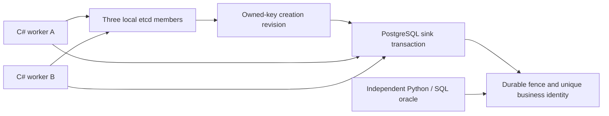

# Fenced Shard Ownership Lab

A small C#/.NET lab that makes a stale-writer failure reproducible: pause one worker, transfer ownership, then resume the old request. The PostgreSQL sink rejects its old fencing generation. A separate durable business identity prevents duplicate effects when the new owner retries an uncertain operation.

Synthetic, local and single-machine only. No exchange, market data, orders, account credentials, strategy, production HA or speed claim.

## Smallest runnable example

Get the [signed preview.8 release](https://github.com/pouriajamali/fenced-shard-ownership-lab/releases/tag/v0.1.0-preview.8): [Windows x64](https://github.com/pouriajamali/fenced-shard-ownership-lab/releases/download/v0.1.0-preview.8/fenced-shard-ownership-lab-v0.1.0-preview.8-win-x64.zip) or [Linux x64](https://github.com/pouriajamali/fenced-shard-ownership-lab/releases/download/v0.1.0-preview.8/fenced-shard-ownership-lab-v0.1.0-preview.8-linux-x64.tar.gz). [Verify its provenance](PROVENANCE.md) with an independently trusted key before execution, then extract it and open the package directory. The [exact runtime source](https://github.com/pouriajamali/fenced-shard-ownership-lab/tree/fd935815bcb11dda722957bc0b4dc3a00b3a5312) is separate from later README edits.

Windows PowerShell:

```powershell
.\ownership.exe --help
.\ownership.exe --version
```

Linux shell:

```sh
./ownership --help
./ownership --version
```

Expected: `--help` prints usage beginning `Ownership Lab: acquire` and the literal-loopback boundary. `--version` prints one JSON object with `product` equal to `fenced-shard-ownership-lab` and a `version` containing `0.1.0-preview.8` and the runtime source commit above. Both commands are offline and need no installed .NET SDK, database, etcd or Python.

For the full stale-writer/retry scenario, see [the named failures and expected outcomes](#start-with-the-failure) and [the current runbook](docs/RUNBOOK.md). It additionally needs Python 3.12, existing Ubuntu 24.04 (WSL on Windows), separately pinned service fixtures and enforced process limits. Its expected final receipt has five unique synthetic effects and total 165, with the stale write rejected and the retry returning its original receipt. Those are fixture invariants, not a benchmark.

## Architecture review

Read the [architecture case study](docs/ARCHITECTURE-CASE-STUDY.md) for the decision, rejected alternatives, failure examples, frozen-release evidence and short English/Persian introductions. Its 10 November 2026 edition and preview.2 evidence remain historical; [preview.8 changes and current delivery evidence](docs/RELEASE-v0.1.0-preview.8.md) describe the current .NET 11 release. Follow the [30-minute four-project review](https://github.com/pouriajamali/trading-execution-lab/blob/main/docs/FLAGSHIP-REVIEW.md) for a guided discussion. The [evidence index](docs/FLAGSHIP-EVIDENCE.json) separates runtime/tag CI from later documentation commits.

## Current release: 0.1.0-preview.8

The [signed Windows/Linux release](https://github.com/pouriajamali/fenced-shard-ownership-lab/releases/tag/v0.1.0-preview.8) uses SDK 11.0.100, net11.0, C# 15.0 and self-contained Core 11.0.0. Its exact runtime source is [`fd935815bcb11dda722957bc0b4dc3a00b3a5312`](https://github.com/pouriajamali/fenced-shard-ownership-lab/tree/fd935815bcb11dda722957bc0b4dc3a00b3a5312), tree `064e2f32c9619842f5b8f7724d0d2930cd9fd806`; later documentation commits do not change those packages.

Each final packaged scenario passed 16 cases and 21 independent SQL snapshots, ending with five unique synthetic effects and total 165. These are local Windows 26H2 x64 and Ubuntu 24.04 WSL2 x64 observations. [Delivery notes](docs/RELEASE-v0.1.0-preview.8.md) retain the exact test-source/reuse boundaries, SDK input proofs, resource profiles, historical failures and six verified downloads. No Actions, CI-PASS status or new CI attestation was produced; no general/formal Windows .NET 11 support, production HA, performance or security certification follows. Archives retain their tested build-time documentation snapshot.

## Historical preview.7 publication

The historical native runtime **0.1.0-preview.7** was built from signed source `bff39cd89822ceba07fce68c4dcdbf5819f09254` and tree `86b1d92d1d4f90a3842b436f6bd4b099c7da3d2d` with SDK **10.0.404** and self-contained Core runtime **10.0.15**. [Exact tag CI, attempt1](https://github.com/pouriajamali/fenced-shard-ownership-lab/actions/runs/43372419271) passed policy, native Windows/Linux and aggregate validation. The [release](https://github.com/pouriajamali/fenced-shard-ownership-lab/releases/tag/v0.1.0-preview.7) provides all six assets; their downloaded hashes and known-key SSH signature were verified.

Fresh evidence from this run: **41 C# units on each OS**, and **8 verifier tests / 27 scenarios on each OS** in normal, `python -O` and `PYTHONOPTIMIZE=1` modes. Native packaged CLI help/version and external-endpoint rejection ran on each OS. Native Linux additionally passed **16 integration cases**; an independent retained-data review compared **21 SQL snapshots**. That fresh integration scope is Linux only. Earlier Windows-to-WSL integration evidence is historical and separate; this run does not establish a new Windows16 result.

Both native packages have347 payload files, full original license/copyright coverage for18 shipped components, manifest/SBOM checks and `localCandidate=false`. The source ZIP contains the exact104 Git blobs at the runtime tag. The archives retain their tested build-time README/source snapshot. Current repository docs and release notes carry later publication status; documentation updates do not rebuild or repack these tested archives. Documentation-only main revisions have a different SHA from the frozen runtime tag source printed above.

Preview.7 retains `UseSharedCompilation=false`, adds only validated `PROGRAMDATA` as the third Windows machine-path key, and uses15-minute native job ceilings. The Linux service allowlist, SDK maps/full notices, C#/SQL, fixtures, ten-second owned-descendant guard, service/Job caps and teardown contracts stay fixed. Linux verify/prepare use4GiB/twoCPU/64 tasks/zero swap; only the explicit native-linux-16 runtime uses128 tasks. Missing actual owned-terminal/release/counter evidence means HOLD, including after a host timeout.

Failed tags preview.3/4/5/6 remain immutable; preview.6 failed Windows command07 while its command01/02 completed. Its Windows XML and hosted SSH inner error/identity were not retained. Controlled local PROGRAMDATA evidence supports the local correction; the fresh preview.7 receipts demonstrate bounded current behavior without proving the old process identity or causal explanation. See [preview.6 history](docs/RELEASE-v0.1.0-preview.6.md) and [preview.7 notes](docs/RELEASE-v0.1.0-preview.7.md).

[Build attestation](https://github.com/pouriajamali/fenced-shard-ownership-lab/attestations/67037698) subjects, source/run/attempt and included-leaf DSSE signature math/canonical workflow SAN were independently checked. Independent Fulcio-root and Rekor trust were **not** verified. No SLSA level, production HA, latency, customer use or general security/certification claim follows. Release SSH signature verification is described in [PROVENANCE.md](PROVENANCE.md).

## Start with the failure

The demo runs these independently checked examples:

| Question | Evidence |
| --- | --- |
| Can a paused old worker write after committed cutover? | `paused-inflight-application-rejected-after-cutover`: rejected, no effect. |
| Did a process die before or after an effect commit? | Before-commit lookup is absent; commit-before-ack lookup finds one durable receipt. Retry uses the same business identity. |
| Does retrying under a new generation duplicate the effect? | Original receipt is replayed; PostgreSQL uniqueness is independent of the fencing token. |
| Does losing two of three etcd members grant new ownership? | Acquisition fails; the demo reports unavailable coordination rather than inventing ownership. |
| What survives an ordinary database process restart? | Committed fencing state, effect identities, hashes and results, checked through a separate SQL-history oracle. |

The frozen preview.2 demo has 15 named cases, including a stable OpenTelemetry trace check. The exact925d1d0 Windows packaged candidate passed all16 cases, including the new composed case. That historical Linux attempt stopped after four cases at its64-task cap. That was a historical failure. Preview.8 native Linux and Windows-paired profiles each passed all16 cases; those results do not relabel the historical failed attempt. The receipt records the actual client OS, version/commit, cases, attempted commands and independent SQL checks. It ends with five unique synthetic effects and total 165. That is a fixture invariant, not trading volume or a benchmark.

## Run the preview

Verified preview.8 downloads: [release page](https://github.com/pouriajamali/fenced-shard-ownership-lab/releases/tag/v0.1.0-preview.8), **[Windows x64](https://github.com/pouriajamali/fenced-shard-ownership-lab/releases/download/v0.1.0-preview.8/fenced-shard-ownership-lab-v0.1.0-preview.8-win-x64.zip)**, **[Linux x64](https://github.com/pouriajamali/fenced-shard-ownership-lab/releases/download/v0.1.0-preview.8/fenced-shard-ownership-lab-v0.1.0-preview.8-linux-x64.tar.gz)** and [source](https://github.com/pouriajamali/fenced-shard-ownership-lab/releases/download/v0.1.0-preview.8/fenced-shard-ownership-lab-v0.1.0-preview.8-source.zip). Download the [four-entry checksums](https://github.com/pouriajamali/fenced-shard-ownership-lab/releases/download/v0.1.0-preview.8/SHA256SUMS.txt), [checksum signature](https://github.com/pouriajamali/fenced-shard-ownership-lab/releases/download/v0.1.0-preview.8/SHA256SUMS.txt.sig) and [112-byte public key](https://github.com/pouriajamali/fenced-shard-ownership-lab/releases/download/v0.1.0-preview.8/SIGNING-PUBLIC-KEY.pub); verify bytes through a previously trusted checkout's verifier and independently trusted fingerprint before executing them. Local builds, private preparation and temporary CI artifacts are separate from published releases.

Historical [preview.2](https://github.com/pouriajamali/fenced-shard-ownership-lab/releases/tag/v0.1.0-preview.2) remains unchanged. Its earlier source/runtime versions and evidence remain separate from preview.7.

Earlier [preview.1](https://github.com/pouriajamali/fenced-shard-ownership-lab/releases/tag/v0.1.0-preview.1) is retained unchanged. Its managed-package SPDX checksums mislabeled normalized NuGet contentHash as a raw signed archive checksum, and its runtime lacked that raw checksum. Preview.2 records the two identities separately and independently verifies actual archive bytes. This metadata correction is not evidence of release-archive or signature tampering.

The native CLI does not require an installed .NET SDK. Python 3.12 and existing Ubuntu 24.04/Linux are needed for the full demo; Windows uses an existing `Ubuntu-24.04` WSL distribution for the servers. No Docker daemon, package installation or paid service is required by this path. The fixture archives are downloaded separately and checksum-pinned.

Use the [offline example above](#smallest-runnable-example) to inspect the package. See [PROVENANCE.md](PROVENANCE.md) to verify source/tag and archive signatures. Git provenance is separate from Windows Authenticode or production suitability.

The server commands below describe frozen historical preview.2 only. They are not current preview.8 reproduction commands. For current-source work, follow [the fixture build contract](docs/ETCD-FIXTURE-BUILD.md) and [the runbook](docs/RUNBOOK.md): preparation and integration require actual aggregate kernel limits before execution. Windows integration additionally requires a bounded native Job and a fresh `--service-unit`. Bare historical commands do not supply those current-source limits. Offline CLI help/version remain separate.

### Historical preview.2 Windows client and Linux services

Run from the extracted package in PowerShell. Use fresh `artifacts` paths for each attempt; existing output directories are deliberately not overwritten.

```powershell
python tools/fetch_services.py --out artifacts/upstream
if ($LASTEXITCODE -ne 0) { throw 'Fixture download failed' }
$linuxHere = (wsl -d Ubuntu-24.04 -- wslpath -a (Get-Location).Path).Trim()
if ($LASTEXITCODE -ne 0) { throw 'Existing Ubuntu WSL access required' }
wsl -d Ubuntu-24.04 -- python3 "$linuxHere/tools/prepare_linux.py" --archives "$linuxHere/artifacts/upstream" --out "$linuxHere/artifacts/services"
if ($LASTEXITCODE -ne 0) { throw 'Linux preparation failed' }
python tools/integration.py --fixtures artifacts/services --cli ownership.exe --out artifacts/demo
if ($LASTEXITCODE -ne 0) { throw 'Demo failed; preserve its evidence' }
Get-Content artifacts/demo/receipt.json
```

### Historical preview.2 native Linux client and services

```sh
python3 tools/fetch_services.py --out artifacts/upstream &&
python3 tools/prepare_linux.py --archives artifacts/upstream --out artifacts/services &&
python3 tools/integration.py --fixtures artifacts/services --cli ./ownership --out artifacts/demo &&
cat artifacts/demo/receipt.json
```

The helpers extract verified upstream `.deb`/tar archives into the selected directory; they do not install packages or change system services. PostgreSQL data lives in a fresh user-owned Linux temporary directory. Each profile owns its processes, binds loopback, and stops those processes at completion. Scratch data/logs are retained for inspection. `connection.private.json` contains an ephemeral lab-only password: keep the whole demo directory private and out of commits, uploads and release archives.

## Architecture and choices



- Current source: SDK11.0.100 / net11.0 / C#15.0 / Core11.0.0 with actual regenerated locks and local native/packaged16 evidence. Historical preview.7 used SDK10.0.404/Core10.0.15; preview.2 used SDK10.0.403/Core10.0.14.
- etcd 3.7.3 is existing consensus; this project does not implement Raft. A small bounded `HttpClient` adapter uses its official v3 gateway.
- PostgreSQL 18.6 / Npgsql 10.0.3 enforce the sink transaction. Two workers plus three etcd members still have one physical host and one database sink.
- xUnit v3 package 4.0.3 covers exact integers, framing, domain bounds and fail-closed validation. The independent SQL oracle reconstructs effects instead of trusting the application's snapshot command.
- OpenTelemetry 1.20.1 can export a whitelisted trace to stderr when `OWNERSHIP_LAB_TELEMETRY=1`. It emits no SQL text, payloads, business identities, credentials or connection strings; default mode is off. This is one trace path, not a hosted observability platform.

[Contract](docs/CONTRACT.md) | [Architecture decision](docs/ADR-001.md) | [Failure matrix](docs/FAILURE-MATRIX.md) | [Runbook](docs/RUNBOOK.md) | [Contributing](CONTRIBUTING.md)

## Important boundaries

Cutover is committed sink activation, not merely lease expiry or election. The sink atomically checks the active generation and writes the effect/receipt. The business deduplication key survives generation changes. A timeout/disconnect is not a rollback receipt: a possibly committed operation is `UNKNOWN` until same-identity lookup/retry resolves it.

An already-started request paused before the state lock is an application-delay fixture, not a measured network-packet delay. The demonstrated sink restart is ordinary process restart. Arbitrary database rollback/restore and coordinator-lineage reset are unsupported; the lab supplies no admission/reset path after them and does not claim universal rollback detection. Workers and the local fixture controller are trusted, non-Byzantine participants; fencing is not authentication.

etcd's documented support is Tier 1 on Linux AMD64/ARM64 and Tier 3 on Windows AMD64. This lab uses the Linux service profile and independently executes native Windows/Linux clients. Shared CI timing and WSL timing are not exchange or hardware latency evidence.

## Build and verify source

Install the pinned SDK in an existing development environment. From this checkout:

```sh
python tools/test_receipt_oracle.py --out artifacts/receipt-oracle-normal
python -O tools/test_receipt_oracle.py --out artifacts/receipt-oracle-optimized
dotnet restore tests/Ownership.Tests/Ownership.Tests.csproj --locked-mode
dotnet run --project tests/Ownership.Tests/Ownership.Tests.csproj -c Release --no-restore -- -noLogo
python tools/test_notices.py --out artifacts/notices-tests
python tools/test_verifier.py --out artifacts/verifier-tests
dotnet restore src/Ownership.Cli/Ownership.Cli.csproj --locked-mode
dotnet build src/Ownership.Cli/Ownership.Cli.csproj -c Release --no-restore
```

The verifier regression creates only a disposable attacker key for negative cases; keep that private work directory out of uploads. It also verifies an actual tiny synthetic fixture signed by the established maintainer key, including normal, -O and PYTHONOPTIMIZE modes. No private maintainer key is needed to run tests.

The full Linux/Windows demo can also use a built DLL with `--cli <absolute-ownership.dll> --dotnet <absolute-dotnet>`. Release packaging requires a clean exact commit and preserves full per-component license texts/copyrights, a shipped-dependency SBOM, manifest and separate external-service lock references. Missing or altered notice text stops packaging. Preview.8 used the authorized local Windows/Linux route and separately executed both full packaged scenarios. Historical CI behavior does not imply a new CI run; Actions remain prohibited for this maintenance.

Original code: MIT. Third-party software and separately downloaded fixtures retain their own licenses; see [NOTICE.md](NOTICE.md). No private/shared project code or data is included.

[CI resource policy](docs/CI-POLICY.md) describes the existing gated pipeline. No workflow was dispatched for this delivery; signed skip-CI commits/tags preserve the no-Actions instruction. Published runtime tags and assets remain immutable.

## Source readability

The current source expands compact C# layout for review. The published preview links identify its frozen runtime release. Formatting preserves complete syntax, token text and values, comments and directives; it does not introduce a runtime behavior or performance claim.

To reproduce a published package, use its exact original runtime source: [v0.1.0-preview.1 source](https://github.com/pouriajamali/fenced-shard-ownership-lab/tree/7c853fde7bf2aeab9bf60f6b6e979cb17738d802) (`7c853fde7bf2aeab9bf60f6b6e979cb17738d802`), [v0.1.0-preview.2 source](https://github.com/pouriajamali/fenced-shard-ownership-lab/tree/ea35e6a664931b1972c348796a9b7edae9e51378) (`ea35e6a664931b1972c348796a9b7edae9e51378`). The current [v0.1.0-preview.8 runtime source](https://github.com/pouriajamali/fenced-shard-ownership-lab/tree/fd935815bcb11dda722957bc0b4dc3a00b3a5312) is `fd935815bcb11dda722957bc0b4dc3a00b3a5312`. Documentation-only `main` revisions are distinct from those frozen runtime commits.

## Build-time sealed linter

Fresh CI/contributor lint imports the exact reviewed public sealed archive; no
producer drive/private receipts or local compiler are required. Managed task
checkouts retain the canonical gate. See [native profile and signed input setup](docs/ACTIONLINT-BUILD.md).
Archive availability and hosted cap acceptance require actual release/CI readback.


## Exact package proof scope

Original producer observation times, native CRL windows and advisory snapshots are retained. Managed proof uses standard online Windows SDK verification and exact reported repository signer; it does not claim every historical certificate is currently valid. Four independently successful package blocks retain their earlier global exit1/HOLD. Retained nuspec/CMS data is separate from the full-license requirement checked for every actual shipped component. See the dated preparation records in the delivery notes.
