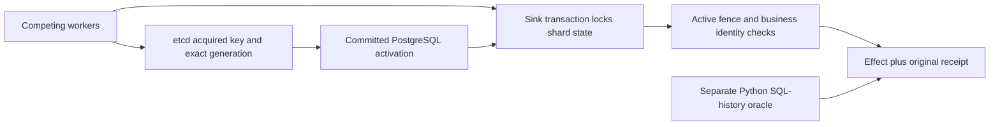

# Fenced Shard Ownership Lab: architecture case study

Documentation edition: 10 November 2026. Original synthetic/local work prepared with AI assistance for Pouria Jamali. This is a selected architecture-and-evidence review, not an exhaustive code or security audit.

Runtime: [`v0.1.0-preview.2`](https://github.com/pouriajamali/fenced-shard-ownership-lab/releases/tag/v0.1.0-preview.2) at `ea35e6a664931b1972c348796a9b7edae9e51378`. The later documentation branch does not replace that runtime identity.

[Machine-readable evidence](FLAGSHIP-EVIDENCE.json) · [30-minute four-project review](https://github.com/pouriajamali/trading-execution-lab/blob/main/docs/FLAGSHIP-REVIEW.md) · [Installation](../README.md)

## Problem: election does not revoke a delayed external write

A worker can pause while it believes it owns a shard, lose its lease and resume after another worker takes over. A second failure boundary appears when an effect commits but its acknowledgement is lost. Election alone cannot answer either question: which writer may change the sink now, and has this business operation already happened?

This lab deliberately separates coordinator ownership, transactional sink admission and business identity. It uses existing etcd consensus; it does not implement Raft.

## Architectural decision: fence at the authoritative sink

An acquired etcd key's creation revision supplies the generation after the gateway confirms the expected owner, lease and lineage using exact integers. A committed PostgreSQL activation defines cutover. A transaction locks one shard state row, checks the active fence and commits the effect, its digest, resulting total and original receipt together. A business operation ID survives ownership changes; its identity does not include the generation.



The sink, not a worker's cached lease belief, enforces the write boundary. Cutover is **committed activation**, not the instant a lease expires. A lost response is unresolved until the same business identity is queried or retried; a new owner can recover an original result without creating another effect.

## Alternatives excluded by this contract

| Alternative | Counterexample / reason | Consequence of the chosen design |
| --- | --- | --- |
| Lease/election without sink fencing | An old in-flight request can outlive its lease | Every effect must pass the authoritative sink transaction |
| Deduplicate by generation plus request ID | Retrying the same business operation under the next generation could count twice | Business identity is independent of coordinator generation |
| Retry a timed-out effect with a new identity | The first effect may already be durable | Same-identity resolution is part of the protocol |
| Accept HTTP 200 as successful renewal | A truncated, mismatched or duplicate-field renewal can still be an HTTP success | Complete, bounded, matching renewal data is required |
| Add homegrown consensus or distributed multi-sink commit | Neither is needed to isolate this failure boundary | One sink row limits concurrency and database loss prevents progress |

These choices establish a narrow correctness contract; they are not throughput comparisons. See the frozen [ADR](https://github.com/pouriajamali/fenced-shard-ownership-lab/blob/ea35e6a664931b1972c348796a9b7edae9e51378/docs/ADR-001.md) and [contract](https://github.com/pouriajamali/fenced-shard-ownership-lab/blob/ea35e6a664931b1972c348796a9b7edae9e51378/docs/CONTRACT.md).

## Counterexamples and named executable evidence

| Counterexample / failure | Observable boundary | Frozen evidence |
| --- | --- | --- |
| Resume an old request paused before the state lock, after new committed activation | Stale transaction is rejected with no effect | `paused-inflight-application-rejected-after-cutover` in [`tools/integration.py`](https://github.com/pouriajamali/fenced-shard-ownership-lab/blob/ea35e6a664931b1972c348796a9b7edae9e51378/tools/integration.py) |
| Commit an effect, kill the owned process before acknowledgement | Same identity resolves one stored result | `effect-commit-before-ack-unknown-resolved` in the same integration fixture |
| Retry the operation under a new generation | Original receipt, no second increment | `idempotency-survives-new-generation`; [`BusinessIdentityDoesNotDependOnGeneration`](https://github.com/pouriajamali/fenced-shard-ownership-lab/blob/ea35e6a664931b1972c348796a9b7edae9e51378/tests/Ownership.Tests/ContractTests.cs) |
| Parse a revision larger than exact double precision | The acquired key's integer must be retained exactly | [`AcquiresExactBeyondDoublePrecisionFromActualOwnedKey`](https://github.com/pouriajamali/fenced-shard-ownership-lab/blob/ea35e6a664931b1972c348796a9b7edae9e51378/tests/Ownership.Tests/GatewayTests.cs) |
| Stop two of three local etcd members | No new acquisition; unavailable coordination is explicit | `real-two-of-three-quorum-loss-denies-new-acquisition` in the integration fixture |

[`PostgresSink.cs`](https://github.com/pouriajamali/fenced-shard-ownership-lab/blob/ea35e6a664931b1972c348796a9b7edae9e51378/src/Ownership/PostgresSink.cs) owns the sink transaction. [`EtcdGateway.cs`](https://github.com/pouriajamali/fenced-shard-ownership-lab/blob/ea35e6a664931b1972c348796a9b7edae9e51378/src/Ownership/EtcdGateway.cs) owns the bounded gateway checks. The independent SQL oracle reconstructs the effect set and total from database history rather than accepting the CLI snapshot as its own proof.

## Versioned evidence and reproduction

The frozen runtime is `v0.1.0-preview.2`. Actual tagged Windows and Linux proof receipts contain **41 unit cases per OS** and native extracted-package checks. The **Linux tag CI additionally runs the 15 service-fault cases**, ending with five unique synthetic effects and total 165, independently checked through SQL. Those are fixture invariants, not financial volume or performance. Windows-to-WSL full-demo observations are a separate local evidence class; they are not inferred from Windows unit CI.

Verify the chosen archive and signed checksums with [PROVENANCE.md](../PROVENANCE.md). From a fresh extracted native Linux package, the frozen [README](https://github.com/pouriajamali/fenced-shard-ownership-lab/blob/ea35e6a664931b1972c348796a9b7edae9e51378/README.md) provides:

```sh
python3 tools/fetch_services.py --out artifacts/upstream &&
python3 tools/prepare_linux.py --archives artifacts/upstream --out artifacts/services &&
python3 tools/integration.py --fixtures artifacts/services --cli ./ownership --out artifacts/demo
```

Inspect `artifacts/demo/receipt.json`, the named cases and the SQL-oracle outcome. Use fresh paths; do not upload the generated lab connection file or whole demo directory. This requires Python 3.12+, existing Ubuntu 24.04 x64 and the separately fetched pinned service archives. The self-contained client needs no installed SDK. Windows uses its native executable and the documented existing Ubuntu-24.04 WSL service profile; use the [runbook](https://github.com/pouriajamali/fenced-shard-ownership-lab/blob/ea35e6a664931b1972c348796a9b7edae9e51378/docs/RUNBOOK.md) rather than running Linux binaries as Windows executables.

These commands are a recipe for a new run, not a claim that this documentation pass reran service faults. Preview.2 corrects archive identity in the SPDX/provenance metadata; the earlier preview remains unchanged and must not be relabeled or overwritten.

## Limits and review questions

- Three etcd members on one machine have one physical failure domain. One PostgreSQL sink is not distributed HA or cross-region availability.
- A pause before the state lock is an application-delay fixture, not a measured network-packet delay. Ordinary process restart is not arbitrary database restore/rollback recovery.
- Trusted non-Byzantine workers and declared lineage are assumed. Fencing is not caller authentication or multi-tenant authorization.
- No broker, live order, account, market feed, speed advantage, exactly-once transport or production suitability is demonstrated.

Review prompts: Which component must reject the stale actor? What is the difference between election and committed cutover? Why must idempotency outlive a generation? What availability and parallelism are deliberately traded for an auditable transaction?

## Short introduction — English

An AI-assisted C#/.NET lab for stale-writer rejection and retry resolution. Existing etcd ownership is separated from PostgreSQL sink fencing and durable business identity, so a new generation does not create a duplicate effect. The fault cases are local, bounded observations rather than a production-HA claim.

## معرفی کوتاه — فارسی

این آزمایشگاه C#/.NET با کمک هوش مصنوعی، رد نویسندهٔ قدیمی و تعیین تکلیف درخواست نامعلوم را نشان می‌دهد. مالکیت etcd، کنترل نسل در PostgreSQL و هویت پایدار عملیات از هم جدا هستند تا تعویض مالک اثر تکراری نسازد. آزمون‌های خرابی محدود و محلی‌اند و اثبات HA در production نیستند.

## Reading the evidence without overstating it

The [evidence index](FLAGSHIP-EVIDENCE.json) records the exact runtime commit/tree, signed tag object, public tag CI, published asset IDs/sizes/SHA256 values and named source checks. Those are existing delivered results, not tests executed for this document. Use the [tag CI](https://github.com/pouriajamali/fenced-shard-ownership-lab/actions/runs/42688162148) and [release](https://github.com/pouriajamali/fenced-shard-ownership-lab/releases/tag/v0.1.0-preview.2) rather than a moving green badge. A CI artifact may expire; the frozen source and signed published downloads remain the reproduction entry points.

The expected SSH fingerprint is `SHA256:AgU5bZlJSjUu0KsWMmVEEr+BfXpcMVNroTA33bHcQdU`; confirm it through an independently trusted channel before accepting a download. AI assistance and laboratory scope remain explicit. A walkthrough can examine a person's understanding; repository count, signatures and passing tests alone do not establish independent skill, employment history, adoption or people-management experience.
